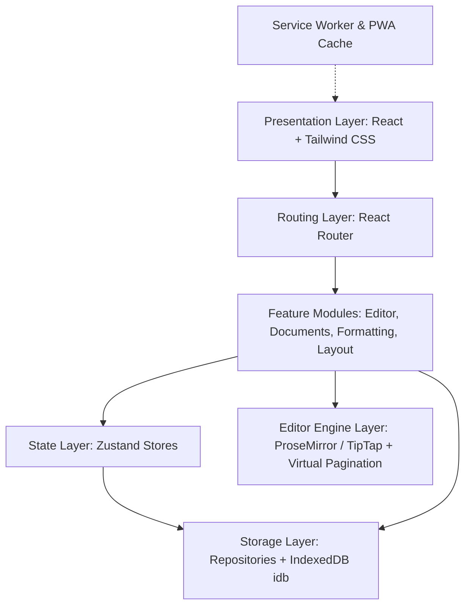

# DC Word Doc — System Architecture

**Architecture Version:** 1.0.0  
**Project:** DC Word Doc  
**Organization:** Damayanti Crest  
**Status:** Approved Architecture  

---

## 1. System Overview

**DC Word Doc** is an enterprise-grade, privacy-first, desktop-class word processor web application built by **Damayanti Crest**. It delivers a true document editing experience with print-accurate page layout, typography controls, and local offline persistence.

---

## 2. Layered Architecture



---

## 3. Directory Structure

```text
src/
├── app/                      # Application bootstrap, routing & providers
│   ├── config/               # App metadata, environment, constants
│   ├── providers/            # Theme, Database, Query/State providers
│   ├── routes/               # Route definitions and layouts
│   └── App.tsx               # Root component
│
├── components/               # Design system & shared UI primitives
│   ├── common/               # Button, Input, Dropdown, Modal, etc.
│   ├── dialogs/              # Confirmation, Alert, Export dialogs
│   ├── feedback/             # Toast, LoadingSpinner, ErrorBoundary
│   └── menus/                # Context menus, Action menus
│
├── editor-engine/            # Decoupled rich text & pagination core
│   ├── adapters/             # Engine bridges (TipTap / ProseMirror)
│   ├── core/                 # Engine lifecycle, editor factory
│   ├── document-model/       # Schemas, node definitions, marks
│   ├── extensions/           # Custom editor extensions
│   ├── pagination/           # Virtual page layout, measurement, page breaks
│   └── selection/            # Cross-page selection coordinates
│
├── features/                 # Modular feature domains
│   ├── dashboard/            # Home overview & recent documents
│   ├── documents/            # Document manager & folder hierarchy
│   ├── editor/               # Document workspace & page viewport
│   ├── formatting/           # Character & paragraph formatting
│   ├── insert/               # Tables, images, breaks, links
│   ├── page-layout/          # Margins, paper sizes, orientation
│   ├── references/           # Footnotes, citations, TOC
│   ├── review/               # Comments, spellcheck, stats
│   ├── settings/             # User preferences & editor settings
│   └── templates/            # Document starter templates
│
├── hooks/                    # Reusable React hooks
├── storage/                  # Persistence layer
│   ├── backup/               # JSON/file export & import
│   ├── database/             # IndexedDB initialization & connection
│   ├── migrations/           # Versioned schema migrations
│   └── repositories/         # Typed data repositories
│
├── stores/                   # Global state management (Zustand)
│   ├── app-store.ts          # Shell, sidebar, modals, notifications
│   ├── document-store.ts     # Active document, metadata, list
│   ├── editor-store.ts       # Editor selection, active marks, stats
│   └── preferences-store.ts  # Theme, defaults, editor view options
│
├── styles/                   # Design tokens, CSS variables, Tailwind
├── types/                    # Core domain types & interfaces
└── utils/                    # Pure helper utilities
```

---

## 4. Separation of Concerns & Data Flow

1. **Editor Content Independence:**
   The editor engine (TipTap/ProseMirror) maintains its own high-performance immutable transaction state. The Zustand `editor-store.ts` tracks *derived* lightweight UI state (active marks, selection position, heading level, word count) to prevent re-rendering the entire React tree on every keystroke.

2. **Persistence Flow:**
   Keystrokes update the EditorView -> A debounced autosave triggers -> Document is serialized to ProseMirror JSON AST -> Saved to `DCWordDocDB` via `DocumentRepository`.

3. **Page Rendering Architecture:**
   The continuous semantic document is projected into discrete visual pages using CSS Paged dimensions (`210mm x 297mm` for A4), page margin offsets, and dynamic widget decorations for page break dividers and headers/footers.
